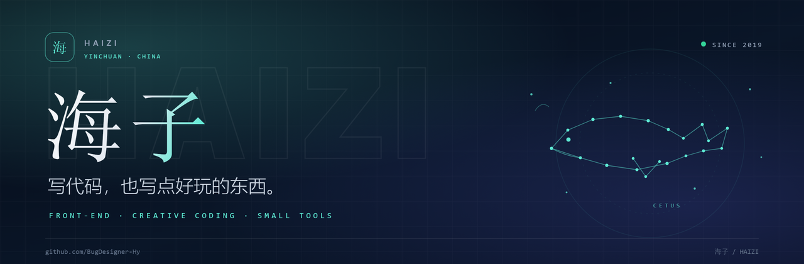
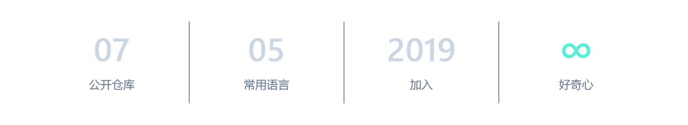
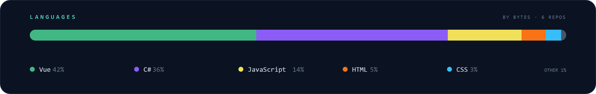

<picture>
  <source media="(prefers-color-scheme: dark)" srcset="./assets/banner-dark.png">
  <source media="(prefers-color-scheme: light)" srcset="./assets/banner-light.png">
  
</picture>

<div align="center">

   [](https://github.com/BugDesigner-Hy)

</div>

### 01 / 关于 <sub>ABOUT</sub>

<table width="100%">
<tr>
<td width="64%" valign="top">
我是<strong>海子</strong>，一个住在银川的开发者。<br><br>
喜欢把脑子里突然冒出来的想法，做成能点、能玩、能留住人的小东西。另外最近在减脂。
</td>
<td width="36%" align="center" valign="top">
<br>
<sub>海子 · Yinchuan</sub>
</td>
</tr>
</table>

```bash
$ whoami
海子 / BugDesigner-Hy

$ pwd
银川, 中国

$ cat now.txt
做点小工具，学点新东西，顺便减个脂。

$ ls stack/
vue3  vite  javascript  webgl  c#  git
```

### 02 / 现在 <sub>NOW</sub>

<p><strong>最近把时间花在三件事上：</strong></p>

<table width="100%">
<tr>
<td width="33%" valign="top">
<strong>🛠️ 在做</strong><br>
<sub>做好玩的东西。</sub>
</td>
<td width="33%" valign="top">
<strong>🏋️ 在练</strong><br>
<sub>健身，顺便减脂。</sub>
</td>
<td width="33%" valign="top">
<strong>🎮 在玩</strong><br>
<sub>打 LOLM。</sub>
</td>
</tr>
</table>

### 03 / 工具箱 <sub>STACK</sub>

<table width="100%">
<tr>
<td width="86"><strong>前端</strong></td>
<td>


</td>
</tr>
<tr>
<td><strong>创意</strong></td>
<td>


</td>
</tr>
<tr>
<td><strong>工具</strong></td>
<td>


</td>
</tr>
</table>

### 04 / 小原则 <sub>PRINCIPLES</sub>

<p><strong>01　先能用，再好看。</strong><br>
<sub>功能是骨架，体验是皮肤。</sub></p>

<p><strong>02　少一点解释，多一点手感。</strong><br>
<sub>好的交互不需要说明书。</sub></p>

<p><strong>03　做小东西，也要有完整的体验。</strong><br>
<sub>从第一眼到最后一秒，都算作品的一部分。</sub></p>

### 05 / GitHub <sub>DATA</sub>

<picture>
  <source media="(prefers-color-scheme: dark)" srcset="./assets/stats-dark.png">
  <source media="(prefers-color-scheme: light)" srcset="./assets/stats-light.png">
  
</picture>

<picture>
  <source media="(prefers-color-scheme: dark)" srcset="./assets/languages-dark.png">
  <source media="(prefers-color-scheme: light)" srcset="./assets/languages-light.png">
  
</picture>

<div align="center">

 

</div>

### 06 / 联系 <sub>CONTACT</sub>

<div align="center">

如果你也在银川，或者也在做小工具，欢迎来 GitHub 打个招呼。

<a href="https://github.com/BugDesigner-Hy"></a> <a href="https://github.com/BugDesigner-Hy?tab=followers"></a>

<sub>如果这里有你喜欢的东西，点个 ⭐ 就是最好的鼓励。</sub>

</div>

---

<div align="center">
<sub>把复杂留给自己，把简单留给用户。</sub><br>
<sub>© 2026 海子 · From Yinchuan with ☕</sub>
</div>
